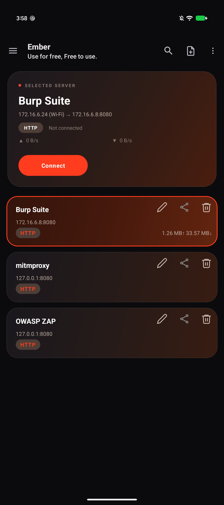

<p align="center">
  
</p>

<h1 align="center">Ember</h1>

<p align="center">An Android proxy client for routing and inspecting network traffic.</p>

<p align="center">
  
  
  <a href="LICENSE"></a>
</p>

## A clear view of your connection

Ember brings proxy profiles, routing rules, and live connection details into a dark interface with flame-orange accents. See your device's network IP and the selected proxy endpoint at a glance, then connect from the main card.

<p align="center">
  
</p>

## Features

- **Proxy profiles:** manage individual servers and subscription groups. Every profile card displays its configured host and port.
- **Connection overview:** the main card shows `device IP (network) → proxy host:port`, connection state, and upload/download speed.
- **Traffic Log:** inspect active connections, filter by host or process, open connection details, and export JSON or CSV. Optional automatic export captures the live connection list when disconnecting.
- **Routing controls:** manage routing rules, block a domain from connection details, and add applications to proxy scope.
- **Interception presets:** create Burp Suite, mitmproxy, or OWASP ZAP profiles and go straight to the editor to configure the endpoint.
- **Android VPN integration:** access per-app VPN settings, certificate installation, and Android's Always-on VPN controls.
- **Secure Browsing:** import a threat-intelligence domain blocklist as a route you can enable or remove.

## Start using Ember

1. Add a profile from **Configuration**, or create a **Subscription** group under **Group** and enter your subscription URL.
2. Review the server address and port in the profile editor.
3. Select the profile and tap **Connect**. Allow the Android VPN permission when prompted.
4. Tap **Stop** to disconnect.

Ember does not provide proxy servers or a VPN subscription. Use your own server or a provider's configuration.

### Inspect live connections

Enable **Settings → Enable Clash API**, start the VPN, and open **Traffic Log**. Tap a connection to see its source, destination, routing rule, proxy chain, and transferred bytes. Use the export menu to save the current list as JSON or CSV.

### Connect to a desktop interception proxy

Choose a Burp Suite, mitmproxy, or OWASP ZAP preset, then enter your desktop's reachable IP and listening port in the editor.

For USB testing, you can also use ADB reverse forwarding:

```sh
adb reverse tcp:8080 tcp:8080
```

Keep the profile endpoint at `127.0.0.1:8080` for that setup. HTTPS interception requires the appropriate proxy CA certificate and an application that trusts it.

## Supported configurations

Protocols include SOCKS, HTTP(S), SSH, Shadowsocks, VMess, VLESS, Trojan, AnyTLS, ShadowTLS, TUIC, Hysteria, and WireGuard. Some protocols require external plugins.

Supported subscription formats include Clash Meta, v2rayN, Shadowsocks, sing-box outbounds, and supported share-link lists. Importing a subscription extracts its proxy nodes rather than the provider's complete routing configuration.

## Build

Requirements:

- JDK 17 or another JDK compatible with Gradle 8.10.2.
- Android SDK platform 35 and Android build tools.
- The native core at `app/libs/libcore.aar`.

```sh
git clone https://github.com/NonBytes/Ember.git
cd Ember
```

Set the Android SDK path through `local.properties` or `ANDROID_HOME`. Prepare the native core using the toolchain setup in [buildScript](buildScript/) and the [CI workflow](.github/workflows/preview.yml), then run [libcore/build.sh](libcore/build.sh) from the `libcore` directory.

Build the release APKs:

```sh
./gradlew :app:assembleOssRelease --console=plain
```

Output: `app/build/outputs/apk/oss/release/Ember-2.0.0-<ABI>-unsigned.apk`. Sign the APK for your device before installing it. Builds are split into `arm64-v8a`, `armeabi-v7a`, `x86`, and `x86_64`.

The application ID is `moe.nb4a`. Updating an existing installation requires a compatible signing certificate.

## Project

Maintained by [NonBytes](https://github.com/NonBytes).

- [Source code](https://github.com/NonBytes/Ember)
- [Issues](https://github.com/NonBytes/Ember/issues)
- [Icon artwork and asset tools](artwork/ember/README.md)

## License

Ember is licensed under the **GNU General Public License v3**. See [LICENSE](LICENSE) and [AUTHORS](AUTHORS).

## Original project and credits

**Ember is based on [MatsuriDayo/NekoBoxForAndroid](https://github.com/MatsuriDayo/NekoBoxForAndroid).** Credit for the original application, Android VPN foundation, and protocol integration belongs to MatsuriDayo and the original contributors. Ember is an independent fork maintained by NonBytes and is not an official NekoBox release.

Additional projects used by Ember and its base application:

- [SagerNet/sing-box](https://github.com/SagerNet/sing-box) — proxy core.
- [SagerNet/SagerNet](https://github.com/SagerNet/SagerNet) and [shadowsocks/shadowsocks-android](https://github.com/shadowsocks/shadowsocks-android) — Android GUI foundations.
- [Yacd-meta](https://github.com/MetaCubeX/Yacd-meta) — web dashboard.
- [HaGeZi DNS Blocklists](https://github.com/hagezi/dns-blocklists) — threat-intelligence feeds.

For inherited configuration and plugin behavior, see the original project's [Android documentation](https://matsuridayo.github.io/nb4a-configuration/) and [plugin guide](https://matsuridayo.github.io/nb4a-plugin/).
